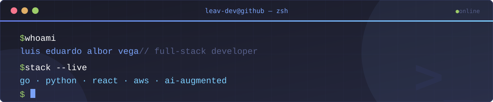
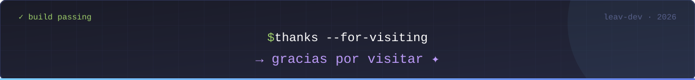

<div align="center">
  
</div>


```yaml
---

name: Luis Eduardo Albor Vega
alias: LEAV
location: Colombia
role: Full-Stack Developer

stack:
  frontend: [React, Angular, TypeScript, JavaScript, TailwindCSS]
  backend:  [Python, Go, Lua, Ruby, Django, FastAPI, Java, C#]
  cloud:    [AWS (S3, Lambda, ECS, EC2, ECR, RDS, CloudFront, Route53, WAF), Docker, K8s]
  database: [PostgreSQL, SQLite]
  ides:     [DBeaver, VSCode, VSCodium, Visual Studio Community, PyCharm]
  tools:    [GitHub Actions, CI/CD, Web Scraping, OpenCV]
  ai:       [opencode, Cursor, gentle-pi, Kiro, MCP, RAG, Prompt Engineering]

experience: 58+ months (desde dic 2021)
focus: Clean Architecture, Scalable Systems, Team Leadership, AI-Augmented Delivery

---
```

<div align="center">
  <h2>Proyectos Destacados</h2>
</div>

<table align="center">
  <tr>
    <td align="center" width="50%">
      <a href="https://github.com/leav-dev/tcode">
        <h3>tcode</h3>
      </a>
      <sub>CLI en Go — repo propio más activo (221 commits)</sub>
      <br /><br />
      
    </td>
    <td align="center" width="50%">
      <a href="https://github.com/leav-dev/tcode-extention">
        <h3>tcode-extention</h3>
      </a>
      <sub>Companion de tcode en Lua/Go/HTML (57 commits)</sub>
      <br /><br />
      
    </td>
  </tr>
  <tr>
    <td align="center" width="50%">
      <a href="https://github.com/leav-dev/homebrew-tcode">
        <h3>homebrew-tcode</h3>
      </a>
      <sub>Homebrew tap for tcode</sub>
      <br /><br />
      
    </td>
    <td align="center" width="50%">
      <a href="https://github.com/leav-dev/shaun">
        <h3>shaun</h3>
      </a>
      <sub>Plataforma de gestión de proyectos basado en Kanban, con arrastrar y soltar, trazabilidad de cambios y SQLite</sub>
      <br /><br />
      
    </td>
  </tr>
  <tr>
    <td align="center" width="50%">
      <a href="https://github.com/leav-dev/utilspress">
        <h3>utilspress</h3>
      </a>
      <sub>Procesamiento de imágenes y PDF</sub>
      <br /><br />
      
    </td>
    <td align="center" width="50%">
      <a href="https://github.com/leav-dev/api-clima">
        <h3>api-clima</h3>
      </a>
      <sub>API meteorológica con FastAPI + OpenWeatherMap. Consulta el clima actual de cualquier ciudad via geocoding. Docker ready.</sub>
      <br /><br />
      
    </td>
  </tr>
  <tr>
    <td align="center" width="50%" colspan="2">
      <a href="https://github.com/leav-dev/bot-detector">
        <h3>bot-detector</h3>
      </a>
      <sub>Bot de automatización GUI basado en detección de imágenes con Python y OpenCV</sub>
      <br /><br />
      
    </td>
  </tr>
</table>

<div align="center">
  <h2>Experiencia Profesional</h2>
  <h3>Grupo Educate Colombia</h3>
  <sub>Desarrollador Full-Stack · QA · Project Manager · Tester · DBA</sub>
  <br />
  <sub>📅 19 feb 2024 — actualidad · 📍 Colombia</sub>
</div>

<table align="center">
  <tr>
    <td width="50%">
      <h4>🔧 Backend — Plataforma empresarial</h4>
      <sub>🔒 Repositorio privado — sin acceso público</sub>
      <br /><br />
      <ul>
        <li>API en <b>Python + Django</b> con <b>PostgreSQL</b>: [N endpoints / módulos principales]</li>
        <li>Microservicios en <b>AWS Lambda</b>: [funciones / eventos que orquestan]</li>
        <li>Rol <b>DBA</b>: modelado de datos, migraciones, optimización de consultas y respaldos</li>
        <li><b>QA / Tester</b>: estrategia de pruebas, ambientes y criterios de aceptación</li>
      </ul>
    </td>
    <td width="50%">
      <h4>🎨 Frontend — Plataforma empresarial</h4>
      <sub>🔒 Repositorio privado — sin acceso público</sub>
      <br /><br />
      <ul>
        <li>SPA en <b>Angular</b> consumiendo la API: [módulos / pantallas principales]</li>
        <li>Rol <b>Project Manager</b>: planificación, sprints y coordinación del equipo de [N personas]</li>
        <li>Impacto: [N usuarios / sedes / procesos digitalizados]</li>
      </ul>
    </td>
  </tr>
</table>

<div align="center">
  <h2>Stack Tecnológico</h2>
</div>

<div align="center">
  <h3>Frontend</h3>
  
  
  
  
  
  

  <h3>Backend</h3>
  
  
  
  
  
  
  
  

  <h3>Cloud & DevOps</h3>
  
  
  
  

  <h3>Base de Datos</h3>
  
  

  <h3>IDEs & Data Tools</h3>
  
  
  
  
  
</div>

<div align="center">
  <h2>Desarrollo Aumentado con IA</h2>
  <p>Trabajo con agentes de IA en el loop: diseño, código, tests y review asistidos. La IA acelera, yo decido.</p>
  
  
  
  
  
  
  <br />
  <sub>Mi stack de agentes: opencode · Cursor · gentle-pi (Pi) · Kiro — automatización con MCP · RAG sobre docs del repo · reviews asistidas con criterio humano</sub>
</div>

<div align="center">
  <h2>Estadísticas</h2>
</div>

<div align="center">
  
  <br />
  
</div>

<div align="center">
  <h2>Conecta conmigo</h2>
  <a href="mailto:luise.albor@gmail.com">
    
  </a>
  <a href="https://www.linkedin.com/in/luis-albor/">
    
  </a>
  <a href="https://github.com/leav-dev">
    
  </a>
</div>

<div align="center">
  
</div>
