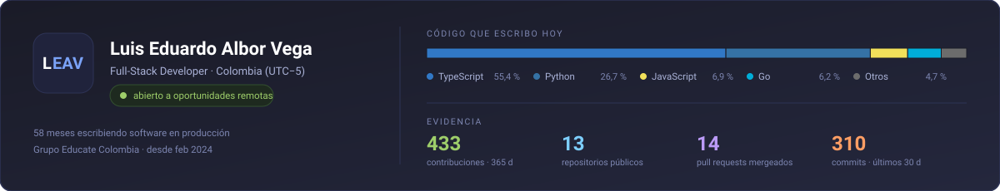
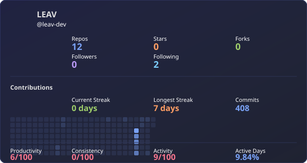
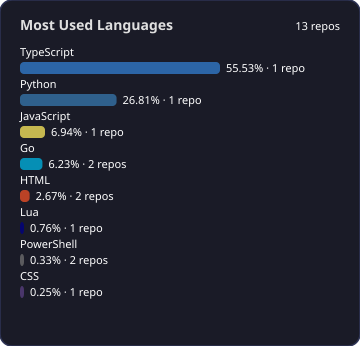

# Luis Eduardo Albor Vega

**Full-Stack Developer** · Colombia (UTC−5) · backend, frontend y datos en el mismo equipo

## Perfil

> Tomo un producto de la idea a producción: backend, frontend, datos y despliegue. Casi cinco años trabajando sobre plataformas reales en Colombia, cubriendo **Django REST Framework + PostgreSQL, SPA en Angular, infraestructura en AWS y la calidad del resultado**. Además mantengo herramientas propias que se instalan con Homebrew: si algo se usa, lo sostengo.

## Dónde encajo

| Equipos chicos de producto | Sistemas que escalan | Entrega con criterio |
| --- | --- | --- |
| Gente que necesita a alguien que mueva backend y frontend sin esperar a tres personas. | Clean Architecture, migraciones y consultas medidas, no adivinadas. | Agentes de IA en el loop de código, tests y review: la IA acelera, la decisión es mía. |
| **5 roles** cubiertos a la vez: dev, QA, tester, DBA y coordinación | **AWS** — Lambda · S3 · EC2 · ECS · RDS · CloudFront · Route 53 · WAF | **CI/CD** con pipelines que compilan y despliegan solos |

## Trabajo seleccionado

| Proyecto | Qué es | Stack | Tipo | Actividad |
| --- | --- | --- | --- | --- |
| [tcode](https://github.com/leav-dev/tcode) | CLI para el flujo de código diario: un binario, sin runtime, `brew install leav-dev/tcode/tcode`. | `Go` `Homebrew` `CI/CD` | Propio | 221 commits |
| [tcode-extention](https://github.com/leav-dev/tcode-extention) | Companion de tcode: capa de extensión con UI, publicada junto al CLI. | `Lua` `Go` `HTML` | Propio | 57 commits |
| [homebrew-tcode](https://github.com/leav-dev/homebrew-tcode) | El tap que hace instalable a tcode en macOS. | `Ruby` | Propio | 7 commits |
| [shaun](https://github.com/leav-dev/shaun) | Gestión de proyectos Kanban con arrastrar y soltar, trazabilidad de cambios y SQLite. | `Astro` `TypeScript` `SQLite` `Docker` | Propio | 26 commits |
| [utilspress](https://github.com/leav-dev/utilspress) | App de escritorio estilo iLovePDF, pero en tu propia máquina: comprime imágenes y PDF sin subir un solo archivo a un servidor. | `Python` `Flet` `Pillow` `PyMuPDF` | Propio | 44 commits |
| [graphify-modules](https://github.com/leav-dev/graphify-modules) | Convierte codebase, docs, esquemas SQL, configs y PDFs en un grafo de conocimiento consultable. | `Python` `MCP` `RAG` | Fork | Mantenido |
| [atreus](https://github.com/leav-dev/atreus) | Agente siempre-on sobre gentle-shell, con disciplina ODD. | `TypeScript` `MCP` | Fork | Mantenido |

Además: [api-clima](https://github.com/leav-dev/api-clima) (FastAPI + OpenWeatherMap, Docker) y [bot-detector](https://github.com/leav-dev/bot-detector) (automatización GUI con Python y OpenCV).

## Experiencia

**Grupo Educate Colombia** — Desarrollador Full-Stack · 19 feb 2024 — actualidad · Colombia · 🔒 repositorio privado

Roles: `Full-Stack` `QA` `Tester` `DBA` `Project Manager`

- **Backend:** API construida con **Django REST Framework** sobre PostgreSQL, y microservicios serverless en AWS Lambda moviendo la lógica que no necesita estar despierta todo el día.
- **Frontend:** SPA en **Angular** consumiendo esa API para las áreas operativas — pantalla y contrato hablando el mismo idioma.
- **Datos:** como DBA, modelado, migraciones y consultas optimizadas, con respaldos que dejaban dormir tranquilo.
- **CI/CD:** armé las pipelines que automatizan builds y despliegues. Un release dejó de depender de la memoria de alguien y de un viernes a la tarde.
- **Calidad:** proyecto con **Sonar** que puso un ojo automático sobre posibles errores y código duplicado, antes de que el problema llegara a producción.
- **Coordinación:** planificación por sprints, criterios de aceptación y estrategia de pruebas para que el equipo no rehiciera lo que ya estaba bien.

El equipo éramos **tres personas, yo incluido**, y entre nosotros cubríamos desarrollo, calidad, datos y planificación. Eso obliga a que cada tarea que se automatiza devuelva tiempo libre: de ahí las pipelines, los chequeos con Sonar y los criterios de aceptación escritos antes del código.

## Stack por nivel

| Nivel | Tecnologías |
| --- | --- |
| **Núcleo** | `TypeScript` `Python` `Go` `Django REST Framework` `FastAPI` `React` `Angular` `PostgreSQL` `AWS` `Docker` `Kubernetes` `GitHub Actions` |
| **Sólido** | `Lua` `Ruby` `C#` `Java` `Astro` `TailwindCSS` `SQLite` `OpenCV` `Web Scraping` |
| **Con IA** | `opencode` `Cursor` `gentle-pi` `Kiro` `MCP` `RAG` |

## Desarrollo aumentado con IA

Trabajo con agentes de IA dentro del loop: diseño, código, tests y review asistidos, con ODD (documento de tarea, specs numeradas, verificación y criterio humano al final). Corro MCP y RAG sobre la documentación y el esquema SQL del repo, y mantengo los agentes que uso.

**La IA acelera, yo decido.**

## Estadísticas

Generadas por el motor de este repo ([`.github/workflows/stats.yml`](.github/workflows/stats.yml)) contra la API de GitHub, sin servicios de terceros.

## Contacto

- 💼 [LinkedIn — Luis Albor](https://www.linkedin.com/in/luis-albor/)
- 🐙 [GitHub](https://github.com/leav-dev)
